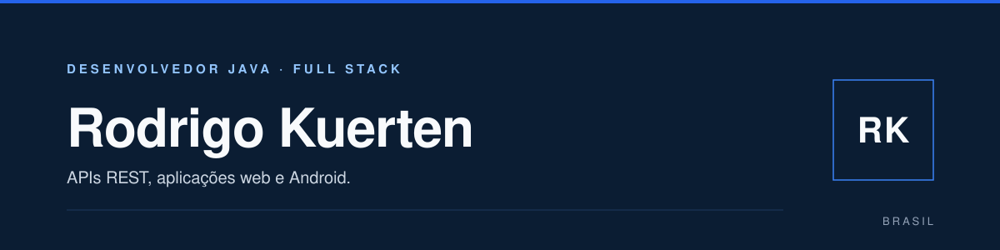

## Sobre

Sou desenvolvedor em início de carreira e atuo como Jovem Aprendiz na área de tecnologia. Meu foco é Java e Spring Boot; também trabalho com Angular, Vue.js e desenvolvimento Android com Java.

Gosto de começar pelo problema: modelo de dados, contrato da API e escopo antes da primeira linha de código. Meu objetivo agora é ganhar profundidade em arquitetura e qualidade de código, mantendo os sistemas simples conforme crescem. Também me interessam automações, OCR e integrações entre sistemas.

## Tecnologias

  <picture>
    <source media="(prefers-color-scheme: dark)" srcset="https://skillicons.dev/icons?i=java,spring,angular,vue,androidstudio,ts,mysql,docker,git,linux&amp;theme=dark">
    
  </picture>

## Projetos

| Projeto | Descrição | Stack |
| :--- | :--- | :--- |
| **[E-commerce Backend](https://github.com/RodrigoKuerten/eccomerce)** | API REST com autenticação, catálogo de produtos e gestão de pedidos. | Java · Spring Boot · Spring Security · Spring Data JPA · MySQL |
| **[Electro Finance](https://github.com/RodrigoKuerten/Electro-Finance)** | Controle de finanças pessoais com receitas, despesas e movimentações por usuário. [Demo](https://electro-finance-ten.vercel.app) | Angular · Spring Boot · MySQL · Docker |
| **[Skills Launcher](https://github.com/RodrigoKuerten/skills-launcher)** | Gerenciador desktop multiplataforma para descobrir, instalar e atualizar skills de agentes de IA. | TypeScript · Rust · Tauri |

## GitHub

  <picture>
    <source media="(prefers-color-scheme: dark)" srcset="https://github-stats-extended.vercel.app/api?username=RodrigoKuerten&amp;show_icons=true&amp;hide_border=true&amp;hide_rank=true&amp;hide=contribs&amp;include_all_commits=true&amp;locale=pt-br&amp;disable_animations=true&amp;bg_color=0B1D33&amp;title_color=93C5FD&amp;text_color=F8FAFC&amp;icon_color=3B82F6">
    
  </picture>

## Contato

[LinkedIn](https://www.linkedin.com/in/rodrigokuerten/) · [GitHub](https://github.com/RodrigoKuerten) · [Portfólio](https://rodrigokuerten.vercel.app) · [E-mail](mailto:rodrigokuerten31@gmail.com)
